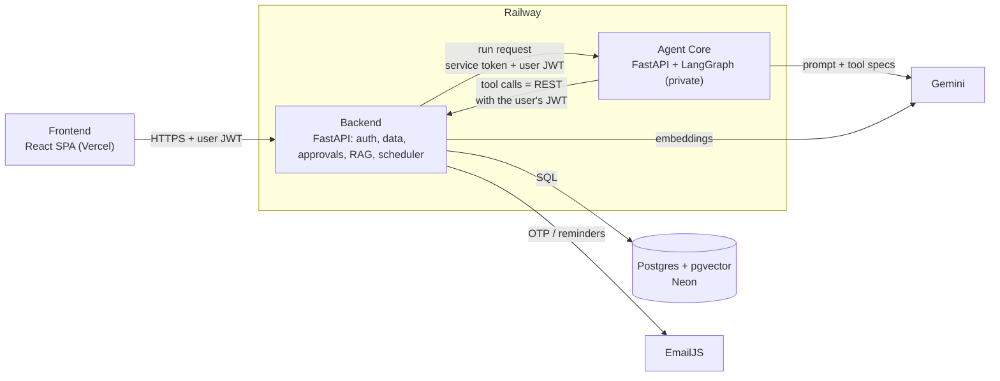
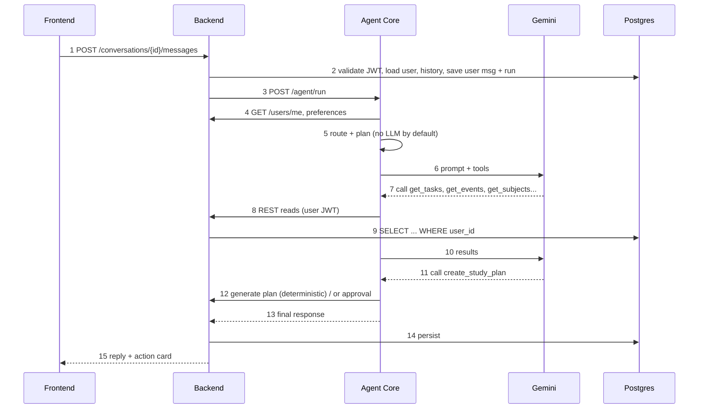
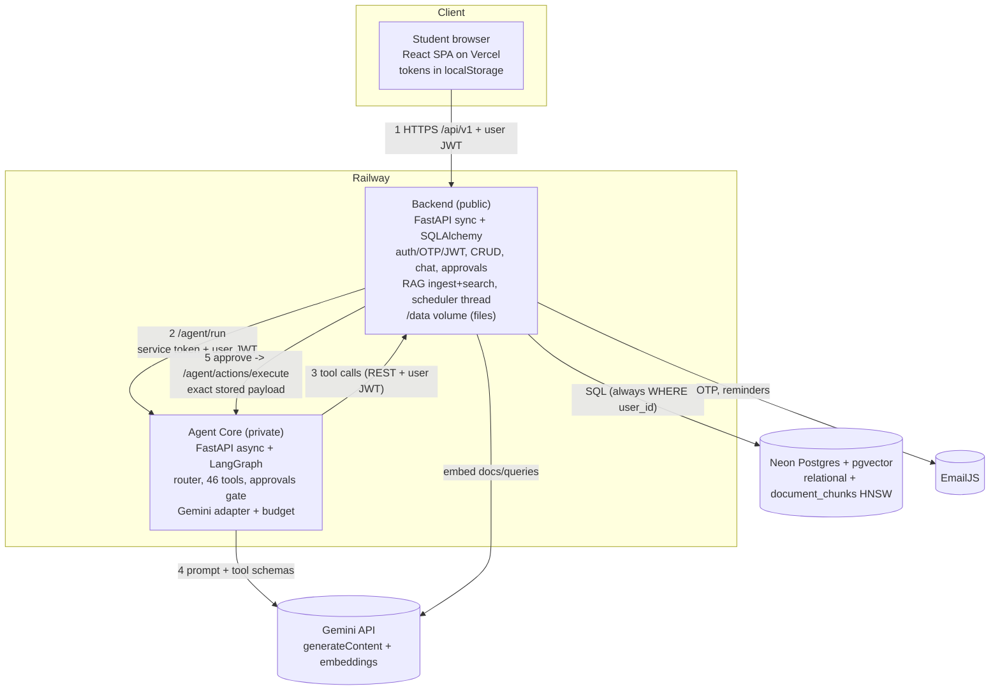

# Understanding and Explaining the Architecture of *It's Personal*

> Beginner-friendly walkthrough, audited against the code (branch `feat/frontend`, 2026-10-26). Companions: [PROJECT_ARCHITECTURE.md](PROJECT_ARCHITECTURE.md) (diagrams, status matrix) and [AI_ENGINEER_INTERVIEW_GUIDE.md](AI_ENGINEER_INTERVIEW_GUIDE.md) (deep Q&A, coding, debugging).
> Labels: **[Implemented]** verified in code · **[Planned/Proposed]** not in the repo · **[Unverified]** can't be confirmed from the repo (e.g. live deployment).

## Contents
1. [What is implemented vs planned](#1-what-is-implemented-vs-planned)
2. [The architecture from scratch](#2-the-architecture-from-scratch)
3. [Request lifecycle: the ML-exam example](#3-request-lifecycle-the-ml-exam-example)
4. [Interview-ready explanations (30 s / 1 / 3 / 5 min) and the whiteboard](#4-interview-ready-explanations)
5. [Conceptual Q&A](#5-conceptual-questions-and-answers)
6. [Architecture challenges](#6-architecture-challenges)
7. [Final learning kit](#7-final-learning-kit)

---

## 1. What is implemented vs planned

| Area | Status | Evidence |
| --- | --- | --- |
| React + TypeScript SPA (chat, approvals, tasks, calendar, reminders, goals, study plan, documents, bills, expenses, budgets, agent runs) | Implemented | `frontend/src/pages/*`, `services/api.ts` |
| FastAPI backend: auth (password + email OTP + JWT), CRUD, chat persistence, approvals, documents, RAG index/search, scheduler | Implemented | `backend/app/**` |
| Agent Core: LangGraph agent, 46 tools, Gemini adapter (+OpenRouter/Anthropic), approvals, memory | Implemented | `agent-core/app/**` |
| PostgreSQL + pgvector (HNSW, 768-dim) | Implemented | migration `0006`, `models/platform.py` |
| Docker, Railway/Vercel/Neon configs | Implemented as config; **live deployment [Unverified]** | `Dockerfile`s, `railway.json`, `vercel.json`, `DEPLOY.md` |
| Mobile app | **[Planned]**, no code (only a responsive web UI) | no `mobile/` folder |
| Streaming, queues, Redis, caching, CI, tracing, eval dataset, LangGraph checkpointing | **[Not present]** | n/a |

---

## 2. The architecture from scratch

### 2.0 The big picture, with an analogy

Think of a **restaurant**:
- **Frontend** = the dining room and menu (what the student sees and touches).
- **Backend** = the kitchen manager and the pantry keys (knows who you are, owns all the data, enforces rules).
- **Agent Core** = a smart assistant waiter who can *read* the order book and *propose* changes, but has no pantry key of its own: it must ask the kitchen manager, showing *your* ID badge each time.
- **LLM (Gemini)** = an expert consultant on the phone. Gives advice and decides which questions to ask; never touches the pantry.
- **Database** = the pantry.
- **RAG** = the waiter looking up a page in *your* uploaded cookbook before answering, and quoting the page.

### 2.1 Frontend  **[Implemented]**
- **What:** React 19 + TypeScript SPA built with Vite, Tailwind, TanStack Query (server-state cache), Zustand (auth/ui state), React Router.
- **Why / problem solved:** gives students one place to see and manage everything; renders chat, approval cards, and the agent's step trace.
- **Receives:** JSON from `/api/v1` (camelCase). **Sends:** user input (messages, forms, file uploads) with `Authorization: Bearer <access token>`.
- **Talks to:** only the backend ([services/api.ts](../frontend/src/services/api.ts)): refreshes the token once on 401, converts the backend's `{error:{code,message}}` into an `ApiError`.
- **Never** talks to Agent Core, Gemini or the database. Secrets never live here; only `VITE_API_URL` is configured (baked in at build time).
- **Why this approach:** a static SPA is cheap to host (Vercel) and independent of the API. Alternative: Next.js/SSR (better SEO and cookie-based auth; unnecessary for a logged-in app).
- Analogy: the dining room. Terms: *SPA, client, server state, optimistic UI*.

### 2.2 Backend  **[Implemented]**
- **What:** FastAPI app ([backend/app/main.py](../backend/app/main.py)); layered: routes → services → SQLAlchemy models.
- **Why:** **single source of truth** and **single authorization point**: users, tasks, bills, conversations, runs, approvals, documents all live here, and every query is filtered by the signed-in user.
- **Receives:** HTTP requests from the browser; HTTP calls from Agent Core (with the user's token). **Returns:** JSON.
- **Responsibilities:** login (Argon2 + emailed OTP, JWT access 30 min / refresh 14 days with rotation), CRUD, chat (`chat.send_message`), persisting agent runs/tool calls/approvals, approval decisions, document upload + indexing + vector search, scheduler (reminders, bills, approvals expiry, indexing), audit log.
- **Talks to:** Postgres, Agent Core, Gemini (embeddings), EmailJS.
- **Why FastAPI:** typed validation with Pydantic, auto OpenAPI, dependency injection, great Python AI ecosystem. Alternatives: Django (batteries, heavier), Node/Nest (one language with frontend).
- Analogy: kitchen manager with the pantry keys. Terms: *REST, authN vs authZ, ORM, transaction, migration*.

### 2.3 Agent Core  **[Implemented]**
- **What:** a second FastAPI service running a **LangGraph** state machine ([graph.py](../agent-core/app/agent/graph.py)).
- **Why:** isolate AI logic (prompts, tools, model providers) so it can change quickly and holds **no database credentials**.
- **Problem solved:** turns "plan my ML revision" into a sequence of safe tool calls and an answer.
- **Receives:** `POST /agent/run` with message, history, user id + service token + the user's JWT. **Returns:** `{status, response, tool_calls, approvals, events, metadata}` (HTTP 200 even when the run failed; look at `status`).
- **Talks to:** Gemini (reasoning), the backend (every tool = one REST call with the user's JWT).
- **Concepts:** *state* (`AgentState`: messages, tool calls, approvals, counters), *nodes* (functions), *edges* (what runs next, some conditional), *tools* (typed functions, 46 of them), *bounded autonomy* (10 iterations, 20 tool calls, 120 s).
- **Why LangGraph:** explicit, inspectable control flow. Alternative: a plain loop (the backend's legacy `agent/runner.py` is one). Honest note: no checkpointer/interrupt/streaming is used.
- Analogy: the assistant waiter with no pantry key.

### 2.4 LLM (Gemini)  **[Implemented]**
- **What:** Google's model called over REST (`generateContent`) by [llm/gemini.py](../agent-core/app/llm/gemini.py) with *function calling* enabled. Pluggable providers (OpenRouter, Anthropic).
- **Why:** understands natural language, decides which tool to call, writes the final answer.
- **Receives:** system prompt + conversation + tool schemas. **Returns:** text and/or `functionCall`s (tool name + JSON args).
- **Does not:** query the database, run code, or execute anything. It only *asks* for tools; Agent Core validates (Pydantic) and executes them.
- **Resilience:** model fallback chain, 1 retry, request budget, friendly errors.
- **Why Gemini:** free tier made the app runnable for students; alternatives (Claude/GPT) may be more reliable at tool use, but **quality was not benchmarked** here.
- Analogy: the expert on the phone. Terms: *token, context window, function calling, temperature (not set here)*.

### 2.5 Database  **[Implemented]**
- **What:** PostgreSQL (Neon in production, Docker pgvector locally) via SQLAlchemy 2 + Alembic (6 migrations).
- **Why Postgres:** relational data with constraints/transactions, plus vectors via pgvector in the same DB, so one query can filter by `user_id` *and* rank by similarity.
- **Stores:** users, preferences, tasks, events, reminders, study plans/sessions, bills/payments/expenses/budgets, goals, documents + chunks (embeddings), conversations, messages, agent_runs, tool_calls, approvals, notifications, audit_logs, refresh_tokens, login_otps.
- **Accessed only by the backend.** Not by the frontend (insecure, couples UI to schema) and not by Agent Core (would duplicate authorization).
- Alternatives: MongoDB (flexible docs, weaker joins/constraints, no benefit here), Redis (cache/queue, not the system of record).

### 2.6 RAG  **[Implemented]**
- **What:** upload → extract text per page (pypdf) → chunk (600 chars, 100 overlap, page-bound) → embed (`gemini-embedding-2`, 768 dims) → store in `document_chunks` (HNSW cosine index).
- **Why:** the LLM doesn't know the student's notes; retrieve the relevant passages and ground the answer in them (with filename + page).
- **At question time:** router detects a document question → `search_documents` tool → backend embeds the query → cosine search **filtered to the user** → drops results < 0.65 similarity → passages go to the prompt → answer with citations; nothing relevant ⇒ "No relevant document content found."
- **Limits:** no reranker/hybrid search/evaluation metrics; scanned PDFs unsupported; only PDF/text indexed; citations are prompt-enforced, not verified.
- Analogy: look up the page in your cookbook, then answer. Terms: *embedding, vector, cosine similarity, ANN/HNSW, chunking, grounding, hallucination*.

### 2.7 Deployment  **[Config implemented; live state Unverified]**
Vercel (SPA) ← browser → Railway backend (public) ⇄ Railway Agent Core (private network, `*.railway.internal`) ; backend → Neon; `VITE_API_URL` and `CORS_ORIGINS` must match each other; `AGENT_CORE_SERVICE_TOKEN` must match on both services; migrations run on backend start; one replica each. Details: [DEPLOY.md](../DEPLOY.md), [PROJECT_ARCHITECTURE.md §8](PROJECT_ARCHITECTURE.md).
*Why `localhost` fails between containers:* each container has its own network namespace; `localhost` is itself. Use the service's private DNS name (`http://backend.railway.internal:8000`) or Compose service name.

### 2.8 Mobile  **[Planned, not implemented]**
Would reuse the same `/api/v1` backend (the point of a shared backend), Expo/React Native, tokens in secure storage, cached reads for offline, push notifications. Needs idempotency keys and streaming/job polling first. See guide §15.

---

## 3. Request lifecycle: the ML-exam example

> "I have an ML exam on Friday. Check my pending tasks and create a study plan."

Legend: 🟦 deterministic code · 🟧 LLM reasoning.

**Step by step (real sequence)**

1. 🟦 **Frontend send.** `useChat.sendMutation` → `chatService.sendMessage` → `api.post` adds `Authorization: Bearer <access>`; creates a conversation first if none. If the access token expired (401), `api.ts` refreshes once and retries. (No client-side timeout is set on `fetch`.)
2. 🟦 **Backend auth.** Route `send_message` ([platform.py](../backend/app/api/v1/routes/platform.py)) runs dependencies: rate limit (30/min per user), `CurrentUser` (decode HS256 JWT, load user, must be active), `UserZone`, and `AccessToken` (kept to forward). `chat.send_message` checks the conversation belongs to the user (`get_owned` → 404 otherwise), loads the last 20 text messages as history, flushes the user message and creates an `agent_run` row (not yet committed).
3. 🟦 **Backend → Agent Core.** `agent/remote.run_remote_agent` does a **blocking** `httpx.post` to `{AGENT_CORE_URL}/agent/run` (timeout 120 s) with `Authorization: Bearer <service token>` and `X-User-Authorization: Bearer <user JWT>`. Agent Core verifies the service token in constant time.
4. 🟦 **Understanding the goal: context.** Graph nodes: `validate_input` (non-empty, ≤ 8000 chars) → `load_context` (`GET /users/me` using the user's JWT, checks `user_id` matches, loads preferences and history; builds a trimmed 12-message window).
5. 🟦 **"Understanding" is keyword routing, not the LLM.** `router.understand`: "tasks" → TASKS; "exam" → EVENTS and STUDY; "study plan" → STUDY; because "plan" + STUDY it's `multi_step`. So the LLM is only shown the **tasks, events and study tool groups** (smaller prompt, fewer wrong choices). `gather_context` skips the data snapshot here (more than two domains means "rely on tools instead"), and no document search happens (no document phrasing).
6. 🟦/🟧 **Plan.** `plan` node asks Gemini for a numbered plan **only if** `LLM_PLANNING=true`; `DEPLOY.md` sets it `false`, so deployed runs use a single static step. *Difference from the idealised "agent plans first" story: planning is optional and mostly skipped.*
7. 🟧 **First Gemini call (`agent` node).** System prompt (rules, today's date/timezone, student name, saved preferences) + the user's message + JSON schemas of the offered tools. Gemini decides to call, typically in one turn, several read tools such as `get_tasks` (open tasks), `get_events`, `get_subjects`, possibly `get_study_sessions`. It returns `functionCall`s; **it does not run them**.
8. 🟦 **Tool execution (`execute_tools`).** For each call: look up in the registry, validate arguments with Pydantic (`extra=forbid`), check permission scope, run the handler with a 20 s timeout. All calls of the turn run concurrently (`asyncio.gather`). A handler is just `BackendClient.list_tasks(...)` etc.
9. 🟦 **Backend answers each tool call.** Each call is a normal authenticated API request (`GET /tasks?status=pending&status=in_progress`…). The backend's service queries Postgres with `WHERE user_id = :me` and returns paginated JSON. (If this passes through another user's id: 404.)
10. 🟦 **Observe.** `observe` summarises results; results (truncated to 12 000 chars each) are appended as one `tool_result` message; loop limits are checked.
11. 🟧 **Second Gemini call.** With the tasks, events and subjects in context, Gemini reasons about what to revise before Friday and calls `create_study_plan(subject="Machine Learning", topics=[...], start_date, days, minutes_per_day, ...)`. Resolving "Friday" uses the date given in the system prompt. **What Gemini contributes:** which tools, which arguments, topic breakdown and the wording of the answer.
12. 🟦 **Creating the plan.** `create_study_plan` is a MUTATE tool, so:
    - `MUTATION_POLICY=approval` (what `DEPLOY.md` sets): **nothing is created.** The validated payload is stored as a pending approval, the model is told "Not done yet: waiting for approval", and the run ends with `approval_required`.
    - `MUTATION_POLICY=direct` (the code default): the tool runs immediately: it calls the backend's `POST /study-plans/generate`, which **deterministically** places sessions in the student's study window around existing events (the LLM does not schedule times), then saves it with `POST /study-plans`.
13. 🟧 **Final answer.** Another Gemini call (or the same turn) produces the explanation, e.g. "I drafted a 5-day ML plan; it's waiting for your approval." `final_response` assembles status/text.
14. 🟦 **Persistence (backend).** `_record` writes `tool_calls` rows (inputs redacted, outputs), an `approvals` row (`payload.args` = exact arguments, 72 h expiry) with `agent_core_approval_id`, updates the run (`waiting_for_approval`/`completed`, duration, model, events), then saves the assistant message (`metadata.steps`, `metadata.actions`) and **commits everything in one transaction**.
15. 🟦 **Back to the browser.** `201` with `userMessage`, `assistantMessage`, `agentRun`. TanStack Query invalidates messages/runs/approvals; the chat shows the reply and an **action card**.
16. 🟦 **User approves.** `POST /approvals/{id}/approve` → backend checks owner/pending/not expired → `POST /agent/actions/execute` with the *stored* payload and the user's token → Agent Core runs `create_study_plan` (generate + save through the backend API) → backend marks approval `approved`, creates a notification, writes an audit log, syncs the chat card.

**Deterministic vs LLM, in one table**

| Deterministic (code) | LLM (Gemini) |
| --- | --- |
| auth, ownership checks, validation, routing by keywords, which tools are offered, tool execution, schema checks, limits and timeouts, session placement in the study window, approvals, persistence | interpreting the request, choosing tool calls and arguments, deciding when to stop, choosing topics, writing explanations; (optional) drafting a plan |

**Failure behaviour (real code)**

| Failure | What happens | Where |
| --- | --- | --- |
| **Gemini fails** (429/5xx/timeout) | retry once if wait ≤ 4 s, then next model in chain; if all fail → `LLMError` → run `failed` with a friendly message; **HTTP 200** from Agent Core; backend stores `FAILED`, user sees "assistant is busy / usage limit". Bad key/model → "misconfigured". | `gemini.py`, `nodes.agent`, `remote._record` |
| **Agent Core unavailable** | backend `httpx.HTTPError` → run `FAILED`, "Couldn't reach the assistant service"; no retry; message still saved | `remote.run_remote_agent` |
| **Database unavailable** | backend: dependency/commit raises → unhandled → `500 INTERNAL_ERROR` generic; `/health/ready` 503. Agent Core side: backend 5xx → `BackendUnavailableError` → "It's Personal is unavailable right now" (retryable) | `errors.py`, `client.py`, `nodes.load_context` |
| **Tool returns an error** | safe message returned to the model as an `is_error` result; model explains or tries again within limits; nothing crashes | `nodes._run_one` |
| **Request times out** | Agent Core: 120 s `asyncio.timeout` → `failed/timeout`. Backend: its own 120 s client timeout → "Couldn't reach…". **Caveat:** if the backend gives up first, Agent Core may still finish and (in `direct` policy) apply writes the user never saw. Per-tool timeout 20 s. | `graph.py`, `registry.py` |
| **Not authorized** | token expired/invalid: backend 401 → frontend refreshes; inside agent: `BackendAuthError` → `UNAUTHORIZED` ("session expired"); wrong `user_id` → `FORBIDDEN`; other user's item → 404 from backend, tool says "not found" | `deps.py`, `nodes.load_context`, `get_owned` |

---

## 4. Interview-ready explanations

**30 seconds.** "It's Personal is a student workspace with an AI assistant. A React app talks to a FastAPI backend that owns the data, authentication and document search on Postgres with pgvector. When a student chats, the backend calls a separate Agent Core, a LangGraph agent that uses Gemini to decide which tools to call. The tools are just calls back to the backend using the student's own token, and any change the agent wants to make is proposed for the student to approve first."

**1 minute.** Add responsibilities: frontend = UI and token handling; backend = single source of truth, auth (password plus emailed code, JWT with refresh rotation), CRUD, persistence of every run, tool call and approval, RAG ingestion and vector search, reminder scheduler; Agent Core = no database, only an HTTP client to the backend, 46 typed tools, bounded loop (10 iterations, 20 tool calls, 120 s); Gemini = reasoning only; Postgres on Neon; Vercel + Railway.

**3 minutes.** Add the lifecycle (steps 1-16 above, compressed): JWT check → backend forwards user token and a service token → router scopes tools → Gemini picks tools → tools hit backend APIs → results back to Gemini → proposal stored as approval → user approves → exact payload executed. Add database (tables above, user_id on every row, one transaction per chat turn) and AI integration (provider adapter, fallback chain, RAG with similarity threshold). End with one limitation.

**5 minutes.** Add design decisions and trade-offs: (1) agent through backend API → one authorization boundary, cost = latency; (2) approvals store the exact payload → no re-generation; cost = no continuation after approval; (3) deterministic router instead of LLM classification → cheap and testable, brittle for paraphrases; (4) Gemini free tier → accessible, unbenchmarked; (5) pgvector in same DB → simple, scale ceiling; (6) synchronous call chain → simple, but blocks a thread and DB session; **weaknesses**: approval not idempotent, default `direct` policy, tokens in localStorage, per-process rate limiter, no eval set, no CI. **Next steps:** idempotency, queue + streaming, Redis, evaluation harness, tracing.

### Whiteboard (draw in this order, ~3 min)
1. Draw 4 boxes left→right: **Browser(React)** – **Backend** – **Agent Core** – **Gemini**. Label arrows with protocol: HTTPS+JWT, HTTP+service token+user JWT, HTTPS+API key.
2. Draw a return arrow **Agent Core → Backend** "tools = REST with user JWT" (the key insight).
3. Under Backend: **Postgres (+pgvector)**; side: **EmailJS**, **Gemini embeddings**, **/data volume**.
4. Mark the **trust boundaries** with dashed lines: public internet | Railway private network | third-party APIs.
5. Number the flow 1-6 for one chat request; star the **approval** step.
6. Write three "limits" under Agent Core: 10 / 20 / 120 s.
7. Draw RAG as a small side flow: Upload → chunk → embed → pgvector; Question → embed → top-k filtered by user.
8. Finish by naming the 2 weaknesses you'd fix first.

---

## 5. Conceptual questions and answers

Format: **Say it** (aloud) · **Simply** · **In this project** · **Follow-up**. Deeper versions are in the [main guide](AI_ENGINEER_INTERVIEW_GUIDE.md).

### A. Architecture fundamentals

**What is system architecture?** *Say it:* the structure of components, what each is responsible for, and how they communicate. *Simply:* the building plan. *Here:* 3 services + DB + external APIs. *Follow-up: "Why does it matter?"* It determines security boundaries, failure modes and how you scale.

**Client-server?** *Say it:* clients request, servers respond. *Here:* browser = client of the backend; the backend is also a client of Agent Core and of Gemini; Agent Core is a client of the backend. *Follow-up: "Can a service be both?"* Yes, that's normal.

**Frontend vs backend?** *Say it:* frontend runs on the user's device and presents; backend runs on servers you control and enforces rules and holds data. *Here:* React vs FastAPI. *Follow-up: "Why can't the frontend enforce permissions?"* Users control their browser; anything client-side can be bypassed.

**REST API?** *Say it:* resources exposed as URLs with HTTP verbs and JSON, stateless. *Here:* `/api/v1/tasks`, `POST /approvals/{id}/approve`, camelCase JSON, `{items,total,page,pageSize}`. *Follow-up: "Is approve RESTful?"* It's an action endpoint on a resource; pragmatic.

**Monolith vs microservices?** *Say it:* one deployable vs many independently deployable services. *Here:* it's closer to a *modular monolith plus one separate AI service*, not microservices. *Follow-up: "Why split?"* credential and authorization isolation, independent iteration; cost: network hop, more ops.

**Why Agent Core separate from the backend?** *Say it:* so the AI layer, which changes often and runs untrusted model output, has no database access and can only act through the same authorized API a user would use. *Here:* `BackendClient`. *Follow-up: "Downside?"* latency, double validation, two deployments; I'd merge if the team were tiny and latency mattered.

**Why not all code in one service?** *Say it:* fault and credential isolation, separate scaling/deploy cadence, clearer ownership. *Here:* but honest: with one replica each, benefits are mostly security and iteration speed. *Follow-up: "Would a bug in Agent Core take the API down?"* Not directly; the backend degrades to "assistant unavailable".

**Separation of concerns?** *Say it:* each part does one job. *Here:* routes (HTTP) → services (rules) → models (data); Agent Core: nodes (steps) / registry (tools) / providers (LLMs). *Follow-up: "Example violation?"* Backend still contains a legacy local agent loop alongside the remote one.

**Single source of truth?** *Say it:* one authoritative place for each piece of data. *Here:* Postgres via the backend; conversations and approvals live in the backend, Agent Core re-reads them. *Follow-up: "Any duplication?"* Agent Core keeps an in-memory approval copy that the deployed path doesn't use, a smell.

**System boundary?** *Say it:* where one system/trust zone ends and another begins. *Here:* browser | backend | Agent Core | third parties; each crossing needs authentication and validation. *Follow-up: "What crosses the Agent Core boundary?"* a service token, the user's JWT, message/history, tool-call JSON.

### B. Request and network flow

**What happens when the user clicks Send?** Walk through §3 steps 1-15. *Follow-up: "What if it takes 2 minutes?"* UI keeps waiting (no timeout/streaming), backend and Agent Core both time out at 120 s.

**How do frontend and backend communicate?** HTTPS, JSON, Bearer JWT via `fetch` in `api.ts`; CORS allows only configured origins. *Follow-up: "What is CORS?"* browser rule that blocks cross-origin reads unless the server's headers allow the origin.

**HTTP vs HTTPS?** HTTPS = HTTP over TLS (encryption, server identity). *Here:* public hops HTTPS; Railway-internal hops are plain `http://*.railway.internal` over a private network. *Follow-up: "Is that OK?"* Acceptable inside a private network; mTLS would be stricter.

**Synchronous request?** Caller waits for the response. *Here:* the whole chat path. *Follow-up: "When async?"* long jobs: queue + poll/stream (proposed).

**Asynchronous processing?** Work continues without the caller waiting. *Here:* document indexing (`BackgroundTasks` + scheduler) and reminders. Don't confuse with Python `async/await`, which is about not blocking threads. *Follow-up:* async I/O inside Agent Core vs background jobs in the backend.

**Timeout?** Max wait before giving up. *Here:* tools 20 s, backend calls from Agent Core 15 s, Gemini 40 s/attempt (90 s total), Agent Core run 120 s, backend→Agent Core 120 s. *Follow-up: "Why shorter inside than outside?"* inner timeouts must be shorter than outer, otherwise the outer one fires first. Here the outer two are equal (120 s), a weak spot.

**Retry?** Try again after failure. *Here:* Gemini (1 per model), embeddings, indexing retries; none between services. *Follow-up: "What's unsafe to retry?"* non-idempotent writes without an idempotency key.

**Service discovery?** How a service finds another. *Here:* static config + Railway private DNS (`agent-core.railway.internal`) via env vars `AGENT_CORE_URL` / `BACKEND_API_URL`. *Follow-up:* in Kubernetes: Service DNS.

**Why does `localhost` differ in containers?** Each container has its own network namespace; `localhost` = itself. Also on Windows `localhost` may resolve to IPv6 while Postgres listens on IPv4, hence `127.0.0.1` in `DATABASE_URL`. *Follow-up: "Why `--host ''` in the Dockerfiles?"* Binds IPv4 and IPv6 because Railway's private network is IPv6.

**What if one service is down?** Table in §3. *Follow-up: "How to make it degrade better?"* circuit breaker, cached reads, non-AI features keep working (they do: CRUD doesn't depend on Agent Core).

### C. Backend and database

**Why FastAPI?** Pydantic validation, DI, OpenAPI, speed, Python ecosystem. *Follow-up: "Why sync endpoints?"* sync SQLAlchemy is simpler; runs in a threadpool.

**PostgreSQL vs MongoDB?** Data is relational with constraints and transactions, plus pgvector. Mongo fits unstructured/evolving documents. *Follow-up: "When Mongo?"* event logs, highly variable schemas.

**ORM?** Maps tables to Python classes (SQLAlchemy), prevents most SQL injection via parameters, but can hide inefficient queries (N+1). *Follow-up:* `lazy="joined"` on `User.preferences` is one example of an explicit choice.

**Transaction?** Atomic, isolated unit of work (ACID). *Here:* a chat turn commits user message, assistant message, run, tool calls and approvals together. *Follow-up: "Risk?"* the transaction is open while waiting for the LLM; also an HTTP side effect can't be rolled back.

**Connection pooling?** Reuse DB connections. *Here:* SQLAlchemy default pool 5+10 with `pool_pre_ping`. *Follow-up: "Why Neon direct URL?"* avoid pooler incompatibilities since the app pools itself.

**Database migration?** Versioned schema changes (Alembic, 6 revisions), run on container start. *Follow-up: "Migration fails during deploy?"* see §6.

**Why not let the frontend connect to the DB?** It would expose credentials, bypass business rules, couple the UI to the schema.

**Why Agent Core via backend APIs?** One place for authorization/validation/audit; the agent gets exactly the user's permissions; schema changes don't break the agent. *Follow-up: "Cost?"* extra latency, N HTTP calls per run.

### D. AI and agent architecture

**LLM vs chatbot vs agent vs workflow?** LLM = the model. Chatbot = LLM + conversation UI. Workflow = fixed steps. Agent = LLM that chooses actions (tools) in a loop toward a goal. *Here:* a workflow skeleton with an agent loop inside. *Follow-up: "Why not a pure agent?"* predictability and cost.

**Why LangGraph?** Explicit graph, typed state, conditional edges, testable nodes. *Honest:* using a small subset. *Follow-up: "What would you use LangGraph features for?"* checkpointing, interrupts, streaming.

**Nodes, edges, state?** Nodes = steps, edges = transitions (conditional ones route on state), state = shared data. *Here:* 9 nodes, `AgentState` with `operator.add` reducers for append-only lists.

**How does the agent decide which tool to call?** The model sees tool names, descriptions and JSON schemas and emits `functionCall`; code validates and executes. The router first narrows which tools it sees. *Follow-up: "Wrong tool?"* error is returned; scoping reduces mistakes.

**Tool calling?** Structured protocol where the model requests a function with arguments. *Here:* `tool_use`/`tool_result` blocks, translated to Gemini's `functionCall`/`functionResponse`.

**Why shouldn't the LLM run arbitrary DB queries?** Injection, data leaks, destructive statements, no per-user authorization. Typed tools with schemas and the user's token constrain it. *Follow-up: "What about text-to-SQL?"* only with a read-only role, row-level security, allowlisted schema.

**Deterministic code vs LLM reasoning?** Code: guaranteed, testable behaviour. LLM: flexible, probabilistic. Use code for anything with rules or side effects; LLM for interpretation. *Here:* study sessions are placed by backend code; the LLM supplies parameters.

**RAG?** Retrieval-Augmented Generation: fetch relevant text, add to the prompt, answer from it. Reduces hallucination and uses private data without retraining.

**Embeddings and vector search?** Embedding = vector capturing meaning; similar texts are near each other; search = nearest neighbours by cosine similarity (HNSW index). *Here:* 768 dims, pgvector.

**Reducing hallucinations?** Ground in retrieved text, require citations, refuse when nothing is found (0.65 threshold), tools instead of guessing, "never invent IDs" prompt rules, approvals. *Honest:* no automated faithfulness check.

**Evaluating reliability?** Unit tests with a scripted LLM (exist), trajectory evals (tool calls expected for prompts), retrieval metrics (recall@k), LLM-judge faithfulness, regression in CI (proposed). *Here:* 139 + 115 tests, no model-quality eval.

### E. Reliability, security, scalability

**Horizontal vs vertical scaling?** More instances vs bigger instance. *Here:* single replica; horizontal blocked by scheduler thread, local volume, in-memory state.

**Stateless service?** Keeps no request-specific state between requests, so any instance can serve any request. *Here:* Agent Core mostly; backend partly.

**Single point of failure?** A component whose failure stops the system: here each service, the DB, the Gemini key, and EmailJS (nobody can sign in without it).

**Load balancing?** Distribute requests across replicas; Railway/Vercel provide it at the edge; not configured by you with one replica.

**Caching?** Store computed results for reuse. *Here:* none; candidates: embeddings of repeated queries, preference lookups (fetched twice per run), prompt prefix.

**Rate limiting?** Cap requests per time. *Here:* per user, fixed window, in memory (auth 20/min, chat 30/min), plus an LLM request budget. *Follow-up:* use Redis for multi-instance.

**Idempotency?** Repeating an operation has the same effect as doing it once. *Here:* present for notifications (dedupe key), indexing claim, OTP use; **missing for approvals**.

**Preventing duplicate tool execution?** `UPDATE … SET status='applying' WHERE status='pending'` checked by `rowcount`, idempotency key on creates, per-run dedupe of identical calls, unique natural keys. *(Proposed.)*

**AuthN vs AuthZ?** Who are you (password + OTP → JWT) vs what may you do (ownership checks, scopes, approvals).

**Isolating users' data?** `user_id` on every row, `get_owned` in every lookup, user filter inside the vector query, agent only holds the user's token. *Proposed:* Postgres Row-Level Security.

**Protecting API keys?** Env vars on the server, never sent to the browser, redacted from logs/tool records, production validators. *Proposed:* secret manager + rotation.

**Scale to 100 000 users?** Queue + workers for agent runs, SSE/polling, async or pooled backend, pgbouncer + read replicas, Redis (rate limits, budgets, idempotency, cache), object storage, per-user LLM quotas and a paid/multi-provider LLM, observability + cost tracking, eval gates. *(Proposed.)*

**Traffic ×10?** Measure first: Gemini quota and concurrency (threads/pool) break first; then DB. Quick wins: fewer iterations, pool sizing, caching, cheaper model for simple intents.

### F. Trade-offs

**Gemini vs others?** Free tier and good enough function calling vs unknown reliability; provider interface limits switching cost. *Follow-up:* choose by measured tool-selection accuracy, latency, cost, data policy.

**Postgres + pgvector?** One store, transactional, per-user filter in SQL; ceiling at very large vector counts. Dedicated vector DB when scale/filters/hybrid search demand it.

**Separate web client from backend?** Independent deploys, reusable API for mobile; cost: CORS and token handling.

**Shared backend for web and mobile?** One business logic and auth; versioned API needed because old mobile builds linger.

**When Redis?** Shared rate limiting, locks, idempotency keys, caching, ephemeral job state.

**When a queue?** Long or bursty work (agent runs, indexing, emails), retries with backoff, decoupling spikes. *Here:* the chat call already justifies one.

**When microservices?** Multiple teams, very different scaling/security needs; not for 1-3 developers.

**Disadvantages of this architecture?** Sync chain latency, non-idempotent approvals, per-process state, no eval/observability, extra hop.

**Redesign from scratch?** Same boundaries but: job-based agent runs with streaming, idempotency from day one, Redis, RLS, eval harness and tracing, content isolation for retrieved text, cookie-based auth or a BFF, CI.

---

## 6. Architecture challenges

Think in this order: **reproduce → locate the hop → read the cheapest evidence → fix → prevent.**

1. **Gemini error but endpoint returns 200.** *Reasoning:* Agent Core reports run failures in the body, not the HTTP code; the backend stores them. *Do:* open `/agent-runs/{id}` (status, `error_message`, `meta.model`/events), read Agent Core logs (`Gemini model unavailable…`, `Gemini API error` with status codes), check `/ready` (`llm` name), quotas and the key. *Prevent:* alert on failed-run rate; surface `error.code` in UI.
2. **Frontend says assistant unavailable but Railway logs show 200s.** *Reasoning:* the 200 may be Agent Core returning `status:"failed"`, or the backend's own 201 with an error message in `metadata.error`; or the browser/CORS/`VITE_API_URL` layer is failing before the request. *Do:* browser network tab (status + body), backend log for the chat request ID, run record, Agent Core logs for that time (note the request ID is not forwarded to Agent Core, so correlate by time/user), `/ready`.
3. **Slow under many simultaneous users.** *Reasoning:* each chat holds a thread + DB connection for the full agent run. *Measure:* `agent_runs.duration_ms`, tool vs LLM time, pool wait (`QueuePool` errors), Gemini 429 rate, CPU. *Fix:* commit/close before the call, size pool, queue the agent call + stream/poll, cache, per-user concurrency limits.
4. **Two requests create the same task.** *Reasoning:* concurrent approve or retried POST, or the model calling `create_task` twice. *Fix:* atomic status transition + idempotency key; client disables the button; unique natural key; per-run duplicate-call detection. Confirm with `tool_calls`/`audit_logs` timestamps.
5. **Agent tries to read another user's documents.** *Reasoning:* assume the model is compromised. The agent holds only the user's JWT, so the backend scopes everything by `user_id`; vector search filters by authenticated user (never from request input); other users' items return 404. *Add:* tests (exist), RLS as defence-in-depth, audit denied attempts.
6. **Migration fails during deployment.** *Current behaviour:* entrypoint runs `alembic upgrade head` with `set -e`, so the container exits; Railway restarts up to 5 times; the old deployment keeps running until the new one is healthy (platform behaviour, **[Unverified]**). *Should:* migrations transactional where possible, backward-compatible (expand/contract), run as a separate pre-deploy job, rollback = redeploy previous image (+ manual `downgrade` if needed), back up before risky migrations.
7. **Gemini temporarily unavailable.** *Current:* model chain → friendly "busy, try again". *Better:* circuit breaker (fail fast), cross-provider fallback (OpenRouter/Anthropic providers already exist), keep non-AI features working (they do), queue and notify when done.
8. **Agent generates an incorrect study plan.** *Reasoning:* separate *parameter* errors (LLM) from *scheduling* errors (deterministic backend). Approval lets the user catch it. *Evaluate:* golden prompts with seeded tasks/events, assert tool args (subject, days, topics, deadline before Friday) and assert generated sessions respect the study window and avoid events (pure code checks); LLM-judge for topic quality; track rejection rate of study-plan approvals as an online signal. *Improve:* better tool descriptions/examples, pass exam date explicitly, validate `days` ≤ days-until-exam in the tool.
9. **Mobile loses connectivity.** **[Planned]** Reads: cached via persisted query cache; writes: queued locally with idempotency keys, sync on reconnect with conflict policy; chat/agent features disabled with a clear offline state; approvals remain pending server-side (TTL 72 h).
10. **DB becomes the bottleneck.** *Measure first:* connection count/wait, slow query log, `pg_stat_statements`, `EXPLAIN (ANALYZE, BUFFERS)`, lock waits, long transactions. *Optimise in order:* hold transactions shorter, fix N+1 and missing/composite indexes (many exist), pool sizing/pgbouncer, cache hot reads, read replica, partition large tables (`messages`, `tool_calls`, `audit_logs`, chunks), HNSW tuning (`ef_search`).

---

## 7. Final learning kit

### 7.1 One complete architecture diagram

Proposed additions (not built): queue + workers, Redis, object storage, tracing/metrics, CI, mobile client.

### 7.2 Glossary
**Agent**: LLM that picks actions in a loop. **Approval (human-in-the-loop)**: change held until the user confirms. **Authentication / Authorization**: who you are / what you may do. **Bounded autonomy**: hard limits on steps/tools/time. **Chunking**: splitting documents for retrieval. **CORS**: browser cross-origin policy. **Context window**: max tokens a model can read. **Cosine similarity**: angle-based similarity of vectors. **Embedding**: vector of meaning. **Function/tool calling**: model emits structured call. **Grounding**: answer from supplied evidence. **Hallucination**: fluent but unsupported output. **HNSW**: graph-based approximate nearest-neighbour index. **Idempotency**: repeat = same effect. **JWT**: signed token (access/refresh). **LangGraph**: graph framework for agents. **Migration**: versioned schema change. **ORM**: object↔table mapping. **pgvector**: Postgres vector extension. **Prompt injection**: malicious instructions in input/documents. **RAG**: retrieve-then-generate. **Rate limiting**: request caps. **Refresh-token rotation**: new refresh token every use. **Service token**: shared secret proving caller is a trusted service. **Single source of truth**: one authoritative store. **Stateless**: no per-request memory in the process. **Tenant isolation**: users can't see each other's data. **Timeout/Retry/Backoff/Circuit breaker**: failure-containment tools. **Trust boundary**: where trust level changes.

### 7.3 The 30 most important questions
1. Describe the architecture and request flow.
2. Why is Agent Core separate and DB-less?
3. How does the agent use the user's identity?
4. Agent vs workflow, which is this?
5. Walk through the LangGraph nodes and stop conditions.
6. How does tool calling work end to end?
7. What can the LLM do versus what must code do?
8. How do approvals work and why exact payload?
9. How can approvals double-apply and how do you fix it?
10. What is `MUTATION_POLICY` and why does it matter?
11. Explain the RAG pipeline and its weaknesses.
12. Why 768 dims, HNSW, cosine, 0.65 threshold?
13. How do you isolate users' data across services?
14. How does login work (password, OTP, JWT, refresh rotation)?
15. Prompt injection: risks and defences here.
16. What happens when Gemini fails/quota is hit?
17. What happens when Agent Core or the DB is down?
18. Why is a sync backend with a blocking call a scaling risk?
19. How would you scale to 100 000 users?
20. When do you need Redis and a queue?
21. Why PostgreSQL + pgvector rather than Mongo or a vector DB?
22. What memory does the agent have?
23. How do you test and evaluate the agent?
24. Debug: HTTP 200 but failed.
25. Debug: duplicate task.
26. Debug: slow chat.
27. Deployment: env vars, CORS, private networking, migrations.
28. Why `localhost` fails between containers.
29. What is implemented vs planned (mobile, streaming, CI, eval)?
30. What would you redesign and why?

### 7.4 Common architectural mistakes (and how to avoid them)
| Mistake | Avoid by |
| --- | --- |
| Letting the model touch the DB or run arbitrary queries | typed tools, user-scoped API, approvals |
| Trusting HTTP status to mean success | check body `status`, log run outcomes |
| Authorization only in the UI | enforce in backend on every query |
| Mutating without idempotency | keys + atomic state transitions |
| Long blocking calls holding DB connections | release sessions, queue long work |
| Untrusted text with system-level authority | delimit as data, instruction hierarchy |
| In-memory shared state with many replicas | Redis / DB |
| No limits on loops/tools/time | bounded autonomy |
| Claiming numbers you never measured | state only verified facts |
| Config drift (CORS, URLs, tokens) | startup validation, `/ready` checks, documented env matrix |

### 7.5 Whiteboard checklist
- [ ] Four boxes + DB + external APIs; protocols labelled.
- [ ] Agent Core → Backend return arrow (tools via REST, user JWT).
- [ ] Trust boundaries marked; where secrets live.
- [ ] One request traced with numbers; approval step starred.
- [ ] LLM role vs deterministic role stated.
- [ ] RAG side flow; user filter noted.
- [ ] Failure paths: Gemini, Agent Core, DB.
- [ ] Limits (10/20/120) and timeouts mentioned.
- [ ] Two weaknesses + fixes volunteered.
- [ ] Implemented vs planned stated.

### 7.6 Mock interview (answer aloud first; open the answer after)

<b>Q1.</b> Give me a 1-minute overview of your system.

Use §4's 1-minute version. Strong: names the 3 services, who owns data, how the agent gets permissions, approvals. Weak: lists technologies without responsibilities.

<b>Q2.</b> Why doesn't Agent Core read the database directly? It'd be faster.

Faster, yes, but it would need DB credentials and would duplicate every authorization rule, and a prompt-injected agent could reach all users' rows. Through the API with the user's token, the agent can never exceed the user's permissions and the backend remains the single source of truth. Trade-off accepted: extra latency and N HTTP calls.

<b>Q3.</b> The student says "delete all my tasks". What stops that?

`delete_task` is `CONSEQUENTIAL`, so it always requires approval regardless of policy; the model's call becomes a pending approval showing the exact payload; loop limits cap how many calls; the user token limits scope to their data. Honest gap: no bulk-delete tool and approval is per call, which is also noisy for the user.

<b>Q4.</b> Approve is clicked twice quickly. What happens?

Today: two requests can both read `pending` and both execute (no row lock/idempotency), possibly creating the item twice. Fix: atomic `pending→applying` update checked by `rowcount`, idempotency key passed to the create call, and disabling the button client-side.

<b>Q5.</b> Why did you choose a keyword router instead of asking the LLM?

Free, fast, deterministic, unit-testable; it narrows the tool list and decides when to retrieve documents without an extra LLM call. Weakness: brittle to paraphrase, so the fallback is to offer all tools when nothing matches; I'd measure router accuracy and consider a small classifier or embedding router.

<b>Q6.</b> Explain what your RAG returns when the answer isn't in the document.

The query embedding's best matches fall below 0.65 cosine similarity, so the backend returns no results and the message "No relevant document content found."; the prompt then tells the model to say so instead of guessing. Caveat: 0.65 was calibrated by hand on one PDF; I'd build a labelled set and measure recall/precision.

<b>Q7.</b> The backend times out at 120 s and so does Agent Core. Problem?

Yes: equal outer and inner timeouts mean either can fire first. If the backend gives up, Agent Core may still complete and, under `direct` policy, apply writes the user never saw. Make the inner timeout shorter than the outer, return a run ID, and move long runs to a job with status polling.

<b>Q8.</b> How would you know your assistant got worse after a prompt change?

I currently couldn't beyond mock-LLM tests. I'd build a golden set of prompts with seeded data, assert tool-call trajectories and arguments, measure retrieval recall and LLM-judged faithfulness, run it in CI, and track failed-run and approval-rejection rates online.

<b>Q9.</b> Scale this 10× next month. First three actions?

1) Measure: run duration split into LLM/tool/DB, pool waits, Gemini 429 rate. 2) Stop holding DB sessions across the agent call and size the pool; add per-user concurrency/rate limits in Redis. 3) Move agent runs to a queue with polling/SSE and secure higher LLM quota; then caching and replicas (after moving files to object storage and the scheduler to a worker).

<b>Q10.</b> What is the weakest part of your architecture?

Pick one and defend it: non-idempotent approvals plus default `direct` policy (data-integrity risk), or the blocking synchronous chain (availability/scale risk). Then give the fix and how you'd verify it.

### 7.7 Knowledge checklist (before claiming expertise)
- [ ] I can draw the system and trace the ML-exam request from memory, marking deterministic vs LLM steps.
- [ ] I can explain every hop's authentication (JWT, service token, forwarded user token).
- [ ] I can explain each graph node and why limits exist.
- [ ] I know exactly when a write is applied (policy `direct` vs `approval`) and what the user sees.
- [ ] I can explain RAG ingestion and retrieval including the user filter and threshold caveat.
- [ ] I can explain each failure case and what the user sees.
- [ ] I can explain why `localhost` breaks between containers and how Railway private networking is used.
- [ ] I can state three limitations and the fixes without being asked.
- [ ] I can separate implemented / planned / unverified (mobile, CI, streaming, eval, live deployment).
- [ ] I never quote performance, accuracy, user or cost numbers I haven't measured.
