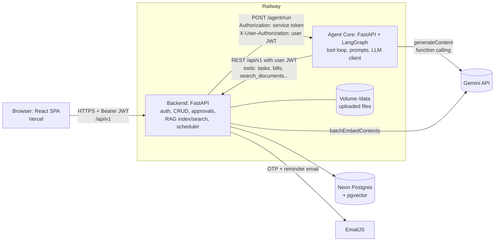
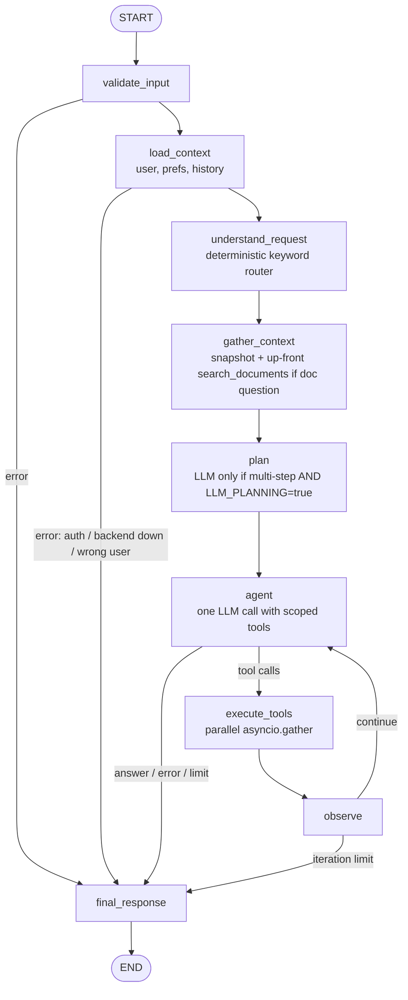
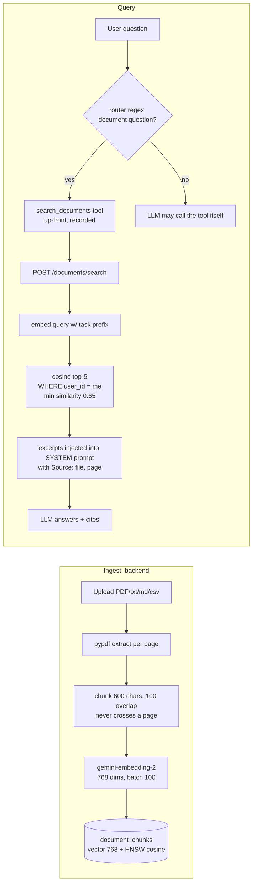
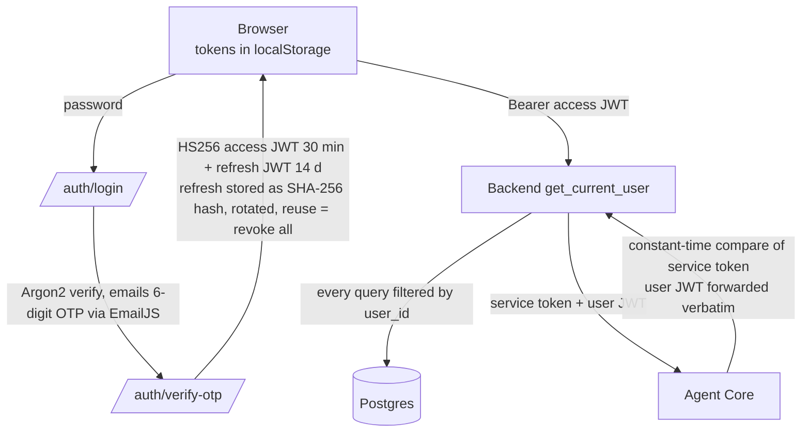
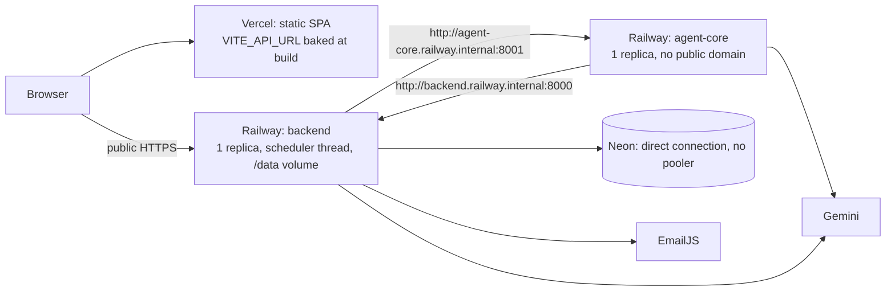
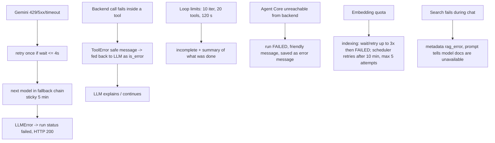

# It's Personal: Project Overview and Architecture

> Written from a code audit of this repository (branch `feat/frontend`). Every statement below was checked against source files; anything I could not verify is labelled **UNVERIFIED** or **PLANNED**. For interview preparation see [AI_ENGINEER_INTERVIEW_GUIDE.md](AI_ENGINEER_INTERVIEW_GUIDE.md).

## 1. What it is

A personal AI workspace for students: tasks, calendar, reminders, study plans, goals, bills/expenses/budgets, and uploaded documents. An assistant (LLM agent) reads the user's data through tools, answers document questions with RAG, and **proposes changes that the user approves** before they are applied (when `MUTATION_POLICY=approval`).

## 2. Three services, HTTP only

| Service | Folder | Stack (verified) | Deploys to (per DEPLOY.md) |
| --- | --- | --- | --- |
| Frontend | [frontend/](../frontend) | React 19, TypeScript, Vite, Tailwind v4, TanStack Query, Zustand, React Router 7 | Vercel |
| Backend | [backend/](../backend) | FastAPI (sync endpoints), SQLAlchemy 2 (sync, psycopg 3), Alembic, Pydantic v2, PostgreSQL + pgvector | Railway (public) |
| Agent Core | [agent-core/](../agent-core) | FastAPI (async), LangGraph, httpx, Pydantic v2; LLM providers: Gemini (default), OpenRouter, Anthropic | Railway (private network only) |
| Database | n/a | PostgreSQL + pgvector (HNSW, 768-dim) | Neon (prod), Docker `pgvector/pgvector:pg18` (local) |

No service imports another. **Agent Core never touches the database**; it calls the backend REST API with the *user's own access token*, so the backend's authorization decides what the agent can see.

## 3. Overall architecture (verified)



Trust boundaries: (1) browser ↔ backend (JWT), (2) backend ↔ Agent Core (shared service token **and** forwarded user JWT), (3) Agent Core/Backend ↔ third-party APIs (API keys in env vars, never sent to the browser).

## 4. Request lifecycle: "Plan my ML revision" (verified path)

```mermaid
sequenceDiagram
  participant FE as Frontend
  participant BE as Backend
  participant AC as Agent Core (LangGraph)
  participant LLM as Gemini
  participant DB as Postgres
  FE->>BE: POST /conversations/{id}/messages (Bearer JWT)
  BE->>BE: rate limit, load user, last 20 msgs as history
  BE->>DB: insert user message, create agent_run (flush, not commit)
  BE->>AC: POST /agent/run (service token + user JWT) [blocking httpx, 120s]
  AC->>BE: GET /users/me, preferences, (history)
  AC->>AC: validate, understand (keyword router), gather snapshot, plan
  loop max 10 iterations / 20 tool calls / 120s
    AC->>LLM: system prompt + messages + tool specs
    LLM-->>AC: text or functionCall(s)
    AC->>BE: tool calls via REST (reads run; writes -> approval if policy=approval)
  end
  AC-->>BE: 200 {status, response, tool_calls, approvals, events}
  BE->>DB: store tool_calls, approvals (pending), assistant message
  BE-->>FE: 201 {assistantMessage.metadata.actions[], agentRun}
  FE->>BE: POST /approvals/{id}/approve
  BE->>AC: POST /agent/actions/execute (exact stored payload)
  AC->>BE: REST write with user JWT
  BE->>DB: approval=approved, notification, audit log
```

## 5. Agent graph (verified: [agent-core/app/agent/graph.py](../agent-core/app/agent/graph.py))



State is a typed Pydantic `AgentState` (`operator.add` reducers for append-only lists). **No LangGraph checkpointer is used**: state lives only for one request.

## 6. RAG pipeline (verified: [backend/app/rag/](../backend/app/rag))



## 7. Auth and security boundaries (verified)



## 8. Deployment and network (documented in [DEPLOY.md](../DEPLOY.md); live state UNVERIFIED by me)



Docker images: [backend/Dockerfile](../backend/Dockerfile) (runs `alembic upgrade head` in [docker-entrypoint.sh](../backend/docker-entrypoint.sh), non-root `app` user), [agent-core/Dockerfile](../agent-core/Dockerfile). Health: `/health` (both), `/health/ready` (backend, checks DB), `/ready` (agent-core, checks backend + LLM configured).

## 9. Failure handling (verified)



## 10. Implementation status matrix

| Capability | Status | Evidence |
| --- | --- | --- |
| LangGraph agent with bounded loop | Implemented, tested | `graph.py`, `tests/integration/test_agent_flows.py` |
| Gemini function calling + model fallback | Implemented, unit-tested with mock transport | `llm/gemini.py`, `tests/unit/test_gemini.py` |
| 46 tools (18 read, 26 mutate, 2 consequential) | Implemented, tested | `tools/*.py`, `tests/tools/` |
| Human approval for writes | Implemented; **only active when `MUTATION_POLICY=approval`** (default is `direct`; DEPLOY.md sets `approval`) | `settings.py:54`, `registry.py` |
| RAG with pgvector | Implemented; vector tests need a real Postgres (8 backend tests skipped on SQLite) | `rag/*`, `test_document_search.py` |
| Memory | Short-term window + 5 whitelisted preferences only | `memory/*` |
| JWT + OTP + refresh rotation | Implemented, tested | `auth_service.py`, `test_auth.py` |
| Scheduler (reminders, bills, indexing) | Implemented (in-process thread or separate process) | `jobs/scheduler.py` |
| Deployed on Railway/Vercel/Neon | Documented; **UNVERIFIED** from the repo | `DEPLOY.md` |
| CI/CD pipeline | **Not present** (no `.github/`); deploys are git-push auto-builds | repo root |
| Evaluation dataset / Retrieval evaluation | Implemented: 32-query benchmark across 5 subjects with threshold sweep (Hit@1 100%, MRR 1.0, 100% rejection @ 0.65 floor) | `backend/evaluation/`, `docs/RETRIEVAL_EVALUATION.md` |
| Rate limiting & Redis backend | Implemented: in-memory per-process default, optional distributed Redis backend via `REDIS_URL` | `backend/app/core/rate_limit.py`, `test_rate_limit.py` |
| Prompt-injection hardening | Implemented: RAG excerpts in defanged `<context>` in user turn, delimiter sanitization, system rule | `agent-core/app/agent/prompts.py`, `test_rag_prompt_hardening.py` |
| Atomic approval execution | Implemented: atomic SQL `PENDING` -> `EXECUTING` state transition, concurrent double-execution guard | `backend/app/services/approvals.py`, `test_approvals_concurrency.py` |
| Non-blocking DB session | Implemented: DB session committed & released before Agent Core HTTP call, reopened for persistence | `backend/app/agent/remote.py`, `backend/app/services/chat.py` |
| Streaming responses, checkpointing, queues | **Not present** | n/a |
| Mobile app (React Native/Expo) | **Not present**; frontend is responsive web only | no `mobile/` folder |
| Frontend tests | **Not present** (`package.json` has dev/build/lint only) | `frontend/package.json` |

Test suite: agent-core **150 passed** (0 failed); backend **127 passed, 8 skipped** (0 failed).

## 10b. Architecture status & hardened items

1. **Approval apply concurrency (RESOLVED)**: Atomic SQL transition (`UPDATE approvals SET status='executing' WHERE id=:id AND status='pending'`) guarantees idempotency and eliminates race conditions.
2. **Database connection pooling (RESOLVED)**: Backend releases and closes the DB session before making the long HTTP call to Agent Core (up to 120 s), returning connections to the pool.
3. **RAG prompt-injection surface (RESOLVED)**: Retrieved passages are quarantined in the user turn inside `<context><source id="..." ...>...</source></context>` with delimiter defanging and explicit untrusted-data instructions.
4. **Tenant isolation (VERIFIED)**: Verified across vector retrieval, document CRUD, agent runs, approvals, and forwarded JWTs across both backend and agent-core.
5. **Rate limiting (DOCUMENTED & EXTENSIBLE)**: By default, single-process in-memory sliding window; setting `REDIS_URL` automatically activates the distributed `RedisRateLimitBackend`. LLM budgets and approval store remain in-process.
6. Tokens in `localStorage` (XSS-exposed).
7. Request ID is not forwarded backend → Agent Core, so traces break at that hop.
8. `AGENT_CORE_MODE` defaults to `local` in the backend; production must set `agent`.
9. Single replica constraints: in-process scheduler and local-volume file storage.
